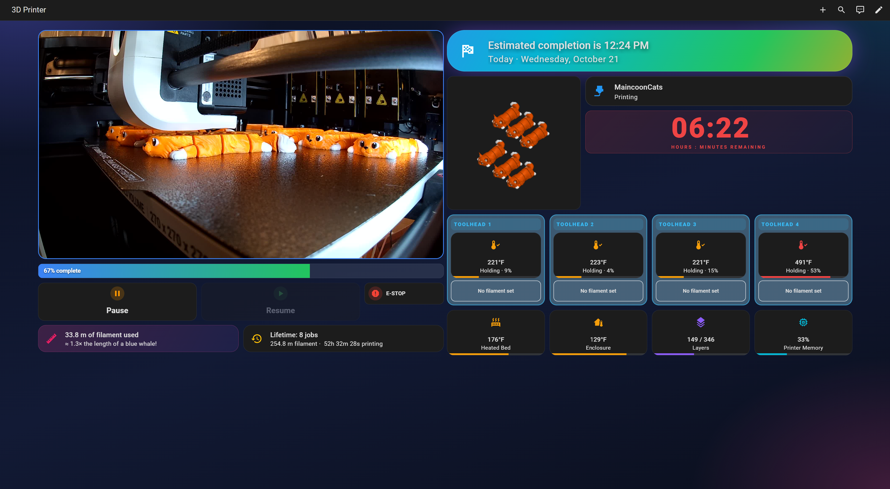
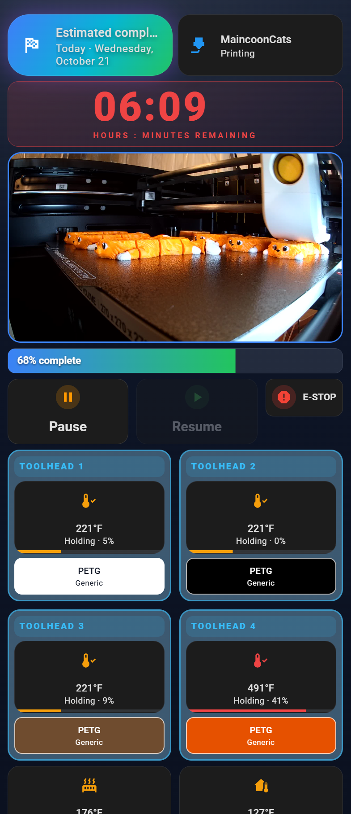

# Snapmaker U1 · Home Assistant Dashboard

A complete, copy-and-paste monitoring setup for the **Snapmaker U1** 4-toolhead 3D printer in
**Home Assistant**: two ready-made dashboards (large desktop screen and phone), a live camera that
stays awake, per-toolhead heating/cooling status with the **filament color, material and vendor** loaded
in each toolhead, bed-cooling progress, a print-stage banner, and email/phone/speaker notifications.

| Desktop | Phone |
|---|---|
|  |  |

*(Screenshots are for illustration; the desktop image's filament boxes are composited from the phone capture. Your dashboard may differ slightly, and the background color is a one-line setting. See [docs/background_options.html](docs/background_options.html) for 8 background choices.)*

## What you get

- **Stage banner**: *Preparing → Printing (with estimated completion time) → Cooling Bed → Complete – Ready to remove print → Waiting for new print job…*
- **Big red countdown** (`HH:MM` remaining) with the elapsed print time under it ("ELAPSED 01:23", then "PRINT TOOK 06:12" when done) and a progress bar
- **Live camera** (about 1 frame per second) with a friendly placeholder when the camera is off
- **Toolhead 1–4 columns**: temperature, **Heating / Cooling / Holding / Sleeping** status with color + icon, heater power %, and a box showing each spool's **color, material and vendor**. The column background follows the state (slate red while heating or holding above 350 °F, slate blue while cooling or holding, slate gray when sleeping), and a toolhead in use shows a red **TOOLHEAD n - ACTIVE** label
- **Heated bed** card with **Heating / Cooling / Holding / Cool** status and a progress bar counting down to **104 °F (40 °C)**, the point where the print is safe to remove
- Enclosure temperature (colored so 90–125 °F reads as healthy), layer count, printer memory
- Print preview (thumbnail), on both desktop and phone, that keeps showing after the print completes, with a placeholder when there is no job. It is one large window that **rotates every 6 seconds** through the slicer thumbnail, the whole model from a second angle, and a picture that **fills in layer by layer** (refreshed every 5 minutes), in the real filament colors, the last two drawn from the print's G-code
- Pause / Resume buttons and an **E-STOP with a confirmation prompt**
- Lifetime stats with **100 fun comparisons** that grow as your filament total grows ("≈ 2.3× the length of the Titanic" … all the way to light-years)
- Notifications when a print finishes (after the bed has cooled): **email with a photo taken at 99 % progress, while the part is still on the bed**, phone push, persistent notification, optional spoken announcement
- **Timelapse downloads**: a card listing the printer's recorded timelapse videos, newest first, with a one-tap **Download latest** link (needs the printer on the network)
- **Two printers?** Fully supported: `customize.py` can build a second set of sensors and automations plus a dashboard with a view per printer (INSTALL.md section 12)
- Snapshot emails at **1 %, 25 %, 50 % and 75 %** of every print

## What you need

| Requirement | Notes |
|---|---|
| A Snapmaker U1 on your network | Note its IP address (give it a fixed IP / DHCP reservation in your router). |
| Home Assistant | A recent version (2024.10 or newer; 2025+ recommended). Any install type. |
| [HACS](https://hacs.xyz) | Used to install the Moonraker integration and two dashboard card libraries. |
| Gmail (or any SMTP mail account) | Only for the email notifications. |

Everything runs locally. No cloud service, no account other than your own Home Assistant.

## Quick start

1. Read **[INSTALL.md](INSTALL.md)** and follow it top to bottom, about 30–45 minutes the first time. It covers installing Moonraker via HACS, the camera keep-alive, all sensors, the automations, Gmail setup and the dashboards.
2. If something does not look right, check **[TROUBLESHOOTING.md](TROUBLESHOOTING.md)**.

## Set it up with Claude (optional)

If you use Claude and have a Home Assistant MCP connection, you can let Claude walk you through the whole install and do the steps it is able to do for you. The repo includes a Claude Skill for this: [`skill/snapmaker-u1-setup/SKILL.md`](skill/snapmaker-u1-setup/SKILL.md).

**Install the skill**

- *Claude app (claude.ai / desktop):* zip the skill folder, then add it under Settings, Capabilities (Skills). From the repo folder: `cd skill && zip -r snapmaker-u1-setup.zip snapmaker-u1-setup`.
- *Claude Code:* copy the folder to `~/.claude/skills/snapmaker-u1-setup/` (or `.claude/skills/` in a project).

**Use it:** make sure your Home Assistant MCP connection is on, then ask something like: *"Use the Snapmaker U1 setup skill to install this dashboard in my Home Assistant."* Claude checks what your connection can do, finds your printer entities, asks for your printer IP and notification entities, and then either makes the changes (with your OK for each) or gives you the exact text to paste.

**What to expect:** Home Assistant's built-in MCP server mainly reads entities, so Claude will often hand you files and YAML to paste. Community Home Assistant MCP servers that can edit files, automations and dashboards let Claude do more. Either way, installing HACS items, restarting Home Assistant, and entering your Gmail App password stay with you. Claude asks before every change, never presses the printer's pause or E-STOP buttons, and never asks for your passwords or tokens.

## What is in this repository

| Path | What it is |
|---|---|
| `INSTALL.md` | The step-by-step install and setup guide |
| `TROUBLESHOOTING.md` | Fixes for the common problems + the list of entities the dashboards expect |
| `customize.py` | Fills in your printer's details in every file (optional, but easiest) |
| `packages/snapmaker_u1.yaml` | All helper sensors in one Home Assistant "package" file |
| `scripts/snapmaker_camera_pulse.py` | Keeps the U1 camera awake |
| `automations/` | Camera keep-alive, thumbnail saver, print previews, print-finished notifications, progress emails |
| `dashboards/desktop.yaml`, `dashboards/phone.yaml` | The two dashboards |
| `skill/snapmaker-u1-setup/` | Claude Skill that guides the install through your Home Assistant MCP connection |
| `www/snapmaker-keep-awake.js` | Optional: keeps the computer screen awake while the dashboard is showing (INSTALL.md, section 11) |
| `docs/lifetime_comparisons.md` | The 100 filament comparisons |
| `docs/background_options.html` | Preview of 8 dashboard background options (open in a browser) |

## Credits and notes

- Printer data comes from the excellent [Moonraker Home Assistant integration](https://github.com/marcolivierarsenault/moonraker-home-assistant).
- Cards: [Mushroom](https://github.com/piitaya/lovelace-mushroom) and [card-mod](https://github.com/thomasloven/lovelace-card-mod).
- The camera keep-alive uses the `camera.start_monitor` method of the Snapmaker U1's Moonraker. If a firmware update changes it, see the camera section of [TROUBLESHOOTING.md](TROUBLESHOOTING.md).
- Not affiliated with Snapmaker. Use the E-STOP button and everything here at your own risk.

License: [MIT](LICENSE)
